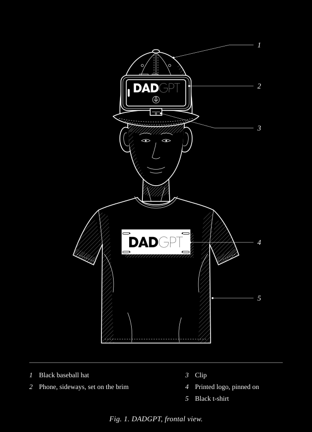
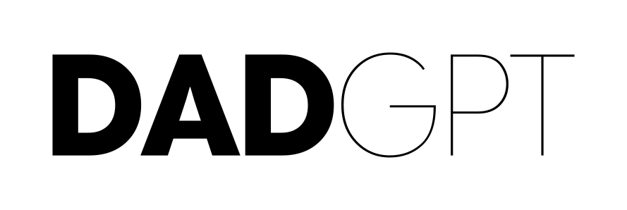
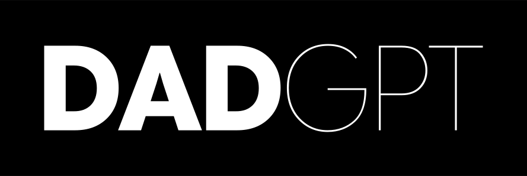

# DADGPT

Ask Dad anything. He answers with a dad joke. Every time.

DADGPT is a voice app. You tap the mic, say something, and Dad replies out loud with one shameless pun. He never gives a real answer, no matter how hard you push.

Roast mode: tap the camera, and Dad snaps a photo and roasts you out loud.

It was built for a Halloween party, so the jokes lean a little cheeky.

## The costume

DADGPT is a Halloween costume. Wear a black t-shirt and a black baseball hat. Set a phone sideways on the brim, screen out, and open the app. Pin the printable logo to your chest. People walk up, tap the mic, and talk to Dad. Or they tap the camera and get roasted. The selfie camera faces out from the brim, so it sees whoever is in front of you.

<p align="center">
  
</p>

## Printable logo

Print it for a sign, a sticker, or the back of your shirt. The SVG and PDF files are vector, so they print sharp at any size. The PDF fills a landscape letter page.

<p align="center">
  
  
</p>

| Version | SVG | PDF | PNG |
|---|---|---|---|
| Black on white | [SVG](docs/logo/dadgpt-logo-black-on-white.svg) | [PDF](docs/logo/dadgpt-logo-black-on-white.pdf) | [PNG](docs/logo/dadgpt-logo-black-on-white.png) |
| White on black | [SVG](docs/logo/dadgpt-logo-white-on-black.svg) | [PDF](docs/logo/dadgpt-logo-white-on-black.pdf) | [PNG](docs/logo/dadgpt-logo-white-on-black.png) |

## How it works

1. You tap the mic and talk. The browser turns your speech into text.
2. The text goes to `/api/chat`.
3. A language model writes one dad joke using the prompt in `lib/dad-prompt.ts`.
4. The reply goes to `/api/speak`, which turns it into a dad voice with OpenAI text to speech.
5. The browser plays it. If the voice fails, it falls back to the built in browser voice.

After two minutes with nothing happening, the chat clears itself so the next person gets a fresh Dad.

## Roast mode

1. You tap the camera next to the mic. The browser asks for camera access the first time.
2. The selfie camera fills the screen with a 3, 2, 1 countdown, then a flash.
3. The photo is shrunk to 768 pixels on its longest side and sent to `/api/roast`.
4. A vision model writes one roast using the prompt in `lib/roast-prompt.ts`. It goes after the costume, outfit, pose, and props, never things people can’t change.
5. Dad says it out loud, same as a joke.

Photos are never saved. Each one goes to the model once and is thrown away. Roast mode is only in live mode, since canned mode has no model to look at the photo.

## Pages

- `/` is the front page. It explains the costume in a click-through and links to both modes.
- `/free` is canned mode. It tells 20 stock jokes with prerecorded audio. It needs no API keys and anyone can use it.
- `/live` is live mode. It writes a new joke for whatever you say, and has roast mode. It needs API keys and can sit behind a passcode. Visitors without the passcode get the prompt to make their own.

## Models

- Jokes and roasts come from `gpt-6-luna` first. It won a blind party face off in the evals.
- `claude-haiku-5-5` is the backup if OpenAI is down or has no key. Both can see photos.
- The voice is `gpt-4o-mini-tts` with the `ash` voice.

## Stack

- Next.js 16 with the App Router
- React 19
- GSAP for all the motion
- Anthropic and OpenAI APIs
- Web Speech API for listening in the browser
- Camera access through `getUserMedia` for roast mode

## Make your own

Paste this into Claude Code or any coding agent. The front page has the same prompt behind its Make your own button.

```text
Set up my own copy of DADGPT, the dad joke costume app at https://github.com/johnpolacek/dadgpt. Read the README first.

1. Clone it and install with pnpm. It needs Node 24.
2. Copy .env.example to .env.local. Ask me for my Anthropic API key and a passcode to lock live mode. An OpenAI key is optional and gives Dad a better voice.
3. Run pnpm dev. Open /live and confirm Dad answers out loud with a joke, and that the camera button roasts a photo.
4. Deploy it to Vercel with the same environment variables, then give me the URL.
```

## Run it locally

You need Node 24 and pnpm.

```sh
pnpm install
cp .env.example .env.local
pnpm dev
```

Open http://localhost:3000.

## Environment variables

| Name | What it does |
|---|---|
| `ANTHROPIC_API_KEY` | Claude Haiku, the backup joke and roast writer |
| `OPENAI_API_KEY` | Luna jokes and roasts, and the dad voice. Leave it empty to use the browser voice |
| `PASSCODE` | Locks everything except `/` and `/free`. Leave it empty to skip the lock |

With no keys at all, canned mode still works.

## Passcode

When `PASSCODE` is set, every page but `/` and `/free` sends you to `/unlock`. API routes return 401. The gate lives in `proxy.ts`. The cookie stores a SHA-256 hash, never the passcode itself.

## Scripts

| Command | What it does |
|---|---|
| `pnpm dev` | Start the dev server |
| `pnpm build` | Build for production |
| `pnpm start` | Run the production build |
| `pnpm record-jokes` | Record the canned jokes to `public/jokes/`. Rerun after you edit `lib/jokes.ts` |
| `pnpm record-voices` | Record the voice lab samples to `public/voices/` |

Both record scripts need `OPENAI_API_KEY` in `.env.local`.

## Lab pages

These pages were used to pick the look, sound, and motion. They sit behind the passcode.

- `/designs` compares font weights for the logo
- `/motion` tries out text animations
- `/particles` tries out particle effects
- `/voices` plays every voice and style side by side

## Project layout

```
app/
  page.tsx          front page
  _about/           the click-through deck
  free/             canned mode
  live/             live mode
  dad-chat.tsx      the chat UI, mic, camera, and audio
  api/chat/         writes the joke
  api/roast/        roasts a photo
  api/speak/        turns the joke into speech
  api/unlock/       checks the passcode
  unlock/           the passcode page
lib/
  dad-prompt.ts     the joke prompt
  roast-prompt.ts   the roast prompt
  joke.ts           model calls for Luna and Haiku
  jokes.ts          the 20 canned jokes
  voice.ts          text to speech
  motion.ts         logo and text animation
  embers.ts         ember effect
  particles.ts      press particles
  passcode.ts       passcode hashing
proxy.ts            the passcode gate
scripts/            audio recording scripts
evals/              prompt and model evals
```

## Evals

The joke prompt was tuned with evals in `evals/`. The roast prompt has no evals yet. It was only spot checked by hand. They run through the local Claude CLI, so they do not spend API credits.

- `evals/failure-modes.md` lists the ten ways Dad went wrong in the first run.
- `build-queries.mjs` and `build-party-queries.mjs` make synthetic test chats.
- `run.mjs` plays each chat through Dad.
- `checks.mjs` has code checks for length, markdown, quotes, and verbal tics.
- `judges.mjs` has LLM judges for things code cannot check, like whether a reply is really a joke.
- `validate-judges.mjs` measures each judge against hand labels.
- `review/server.mjs` is a small labeling UI at http://localhost:4173.

Run a set of chats and judge them:

```sh
node evals/run.mjs v5
node evals/judge-run.mjs v5
```

Run the code check tests:

```sh
node --test evals/checks.test.mjs
```

## Deploy

It runs on Vercel with no extra config. Add the environment variables in the project settings. Set `PASSCODE` if you add API keys, or anyone can spend your credits on `/live`.

## License

MIT
